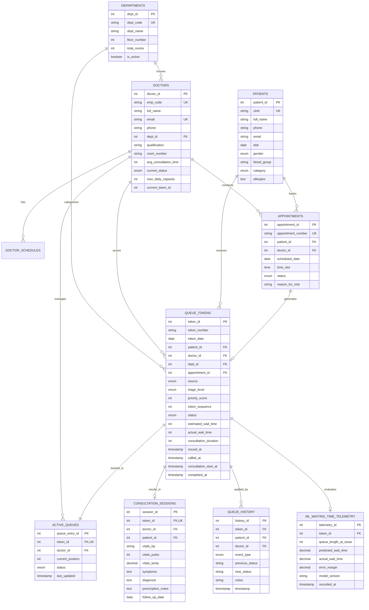

# Database Design & Entity-Relationship Architecture
## Healthcare Queue Management System (MySQL 8.0)

### 1. Mermaid Entity-Relationship Diagram (ERD)

### 2. Relational Schema Normalization Analysis
- **1NF Compliance:** All attributes contain indivisible scalar values; no repeating arrays or comma-delimited strings in core relational keys; primary keys explicitly defined for all 10 relations.
- **2NF Compliance:** There are no partial functional dependencies. In `queue_tokens`, candidate key `(token_date, token_number)` determines non-key attributes entirely, and synthetic surrogate key `token_id` is the primary key.
- **3NF Compliance:** No non-prime attribute is transitively dependent on any candidate key. Physician room numbers and qualifications are stored solely in `doctors`, not duplicated into `queue_tokens` or `active_queues`.
- **BCNF Compliance:** Every determinant in the relational schema is a candidate key.
